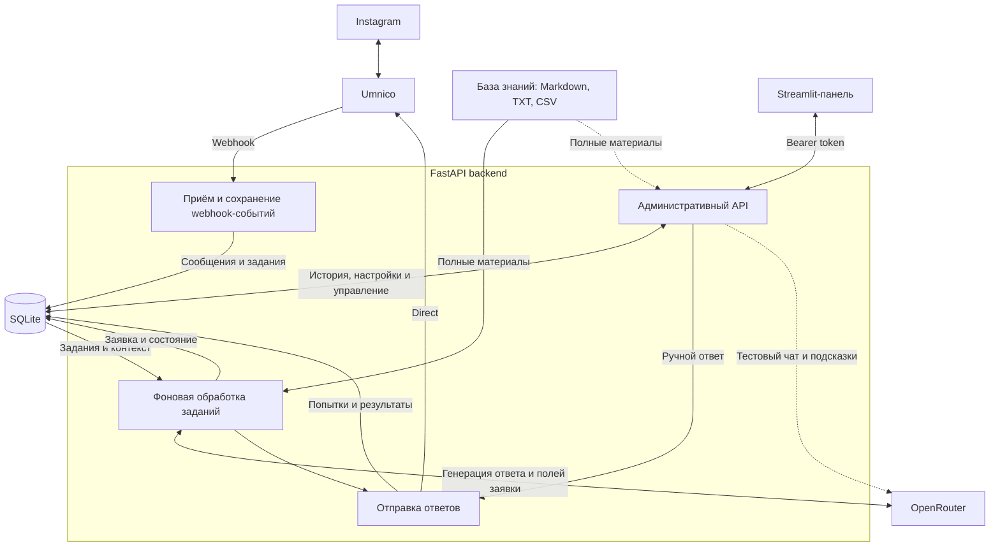

# AI Consultant — Instagram Sales Assistant

AI-консультант автоматизирует консультации покупателей в Instagram через Umnico:
отвечает на основе базы знаний компании, уточняет потребность и последовательно
формирует заявку. Текущая предметная область — подбор диванов и связанные
услуги мебельного бизнеса.

Целевая модель продукта — автономный AI-агент: после настройки он обрабатывает
обращения без открытой панели и постоянного участия человека. Административная
панель служит настройке, диагностике, отладке и вмешательству при разборе проблем.
Сейчас новые переписки создаются на паузе и требуют ручной активации; автоответы
доступны активному боту в Direct.

## Демонстрация

Синтетический пример сценария, а не запись реального диалога или результат
запроса к модели:

> **Покупатель:** Нужен угловой диван для ежедневного сна.
>
> **Консультант:** Какая ширина дивана вам подойдёт?
>
> **Покупатель:** До 230 см, бюджет до 5000 рублей.
>
> **Консультант:** В каком городе планируете покупку?
>
> **Покупатель:** Минск, хочу купить в декабре. Телефон пока не оставлю.

Пример частично заполненной заявки:

| Поле | Данные из сообщений покупателя |
| --- | --- |
| Тип и характеристики | Угловой диван; для ежедневного сна |
| Размеры | До 230 см |
| Бюджет | До 5000 рублей |
| Город и срок покупки | Минск; в декабре |
| Имя и телефон | Не заполнены |

Знакомиться с консультациями можно через изолированный «Тестовый чат» в панели
или CLI без подключения Instagram — см. [быстрый старт](#быстрый-старт).

## Основные возможности

- Консультации на русском языке с учётом истории, ранее собранных данных
  и материалов компании в Markdown, TXT и CSV.
- Постепенное заполнение полной или частичной заявки: имя, телефон, тип
  и характеристики дивана, размеры, бюджет, город и срок покупки.
- Общий контекст Direct и комментариев одного обращения Umnico;
  импорт истории без генерации ответов на старые сообщения.
- Автоответы активного бота в Direct, подсказки по запросу на паузе
  и ручное вмешательство для отладки.
- Выбор модели, обновление базы знаний, просмотр переписки, заявок и ошибок API
  через административную панель; отдельный тестовый чат без клиентских записей.

## Архитектура



Фоновый обработчик запускается внутри одного процесса backend; отдельного брокера
очереди нет. Полученное сообщение сохраняется до генерации ответа, задания
и попытки отправки хранятся в SQLite. Остановка панели не останавливает backend.

При каждой консультации модель получает все загруженные материалы целиком вместе
с контекстом диалога. Поиск и нарезка документов не реализованы; это не RAG.
Данные поста могут дополнять текстовый контекст, а фото отображаться в панели,
но визуального анализа фотографий моделью нет.
Подробности компонентов и маршрутов — в [архитектуре и API](docs/ARCHITECTURE.md).

## Инженерные решения

| Решение | Назначение и обоснование |
| --- | --- |
| Событийная обработка и очередь SQLite | Приём webhook отделён от запросов модели и отправки. Задания сохраняются между запусками; при старте возобновляется прерванная генерация, если отправка ещё не была зарезервирована. |
| Дедупликация и контроль актуальности | Идентификаторы сообщений защищают от повторной обработки событий. Новые сообщения, пауза и ручной ответ отменяют устаревшие задания; версия генерации проверяется перед сохранением и отправкой. |
| Хранение попыток и ограничение повторных отправок | Попытка фиксируется до сетевого запроса. Повтор с тем же `request_id` возвращает сохранённый результат; состояние `unknown` блокирует новые отправки в переписке, включая после перезапуска. |
| Структурированная заявка с проверкой данных | Парсер проверяет JSON, допустимые поля и длины. Новые значения и операции изменения заявки должны подтверждаться цитатами из входящих сообщений. |
| Полный снимок базы знаний | Все загруженные документы включаются в контекст без поискового индекса. Лимиты ограничивают объём; неудачное обновление сохраняет предыдущий снимок. |
| Backend отдельно от административного интерфейса | FastAPI выполняет обработку независимо от Streamlit; административные операции требуют Bearer token. Панель используется для настройки и диагностики агента. |
| Раздельные окружения и изолированный тестовый чат | `local`, `staging` и `production` имеют явную конфигурацию. В staging штатные внешние API заблокированы; явно указанный файл с отдельным ключом разрешает только тестовый маршрут OpenRouter. Тестовый диалог не создаёт клиентских сообщений, заявок и заданий в SQLite и не отправляет сообщения в Umnico. |
| Развёртывание на VPS | systemd управляет отдельными процессами backend и панели; Nginx завершает HTTPS и ограничивает доступ. Staging и production используют раздельные данные, конфигурации и системных пользователей. |

Механизмы обработки и отправки реализованы в
[storage.py](src/ai_consultant_bot/storage.py),
[processing.py](src/ai_consultant_bot/processing.py) и
[messaging.py](src/ai_consultant_bot/messaging.py);
формирование контекста и проверка заявки — в
[consultation.py](src/ai_consultant_bot/consultation.py) и
[knowledge.py](src/ai_consultant_bot/knowledge.py).

## Технологический стек

| Категория | Технологии |
| --- | --- |
| Язык и библиотеки | Python 3.13, FastAPI, Uvicorn, Streamlit, HTTPX, Loguru, python-dotenv |
| Внешние сервисы | Umnico — интеграция Instagram; OpenRouter — доступ к языковым моделям |
| Хранение и инфраструктура | SQLite, Linux VPS, systemd, Nginx, HTTPS; tuna для локального webhook |
| Инструменты разработки | mise, uv, pytest, Ruff; Node.js для отдельных тестов JavaScript |

## Быстрый старт

Предпочтительный сценарий знакомства — локальная проверка консультаций без
Instagram. Установите mise и uv; все команды ниже выполняются из корня репозитория.

1. Подготовьте Python 3.13 и зависимости:

   ```console
   mise trust
   mise install python@3.13
   mise run setup
   ```

   Если Python уже установлен через mise, повторная установка не нужна.
   `setup` выполняет `uv sync` и подготавливает `.venv`; команды запуска используют
   `--no-sync`.

2. Выполните [настройку изолированного локального окружения](docs/SETUP.md#локальная-разработка-параллельно-с-production):
   создайте `.env.development` с отдельной SQLite в режиме `staging`,
   `.env.model-test` с ключом OpenRouter и `mise.local.toml` с параметрами запуска.
   В инструкции приведены образцы и генерация токенов. Существующий `.env`
   не перезаписывайте; учётные данные Umnico и HTTPS-туннель здесь не нужны.

3. Запустите backend и панель в двух терминалах:

   ```console
   mise run start
   ```

   ```console
   mise run panel
   ```

4. Откройте [панель на localhost](http://127.0.0.1:8501), выберите «Тестовый чат»
   и напишите от лица вымышленного покупателя. Ответ и поля заявки используют
   текущую логику консультации и загруженную базу знаний. Материалы из
   `knowledge_base/` перечитываются при запуске backend и по кнопке обновления
   в настройках панели.

**Тестовый чат обращается к настоящему OpenRouter и может выполнять платные
запросы.** Текст диалога и материалы бизнеса передаются внешнему сервису;
используйте синтетические данные. История тестового чата хранится в памяти сессии
панели, отдельно от клиентских переписок.

После подготовки `.env.model-test` можно проверить консультацию в CLI без backend
и панели:

```console
mise run model-test -- --message "Здравствуйте, нужен диван" --message "Для ежедневного сна"
```

Этот сценарий также использует реальный OpenRouter и может быть платным.
Он проверяет консультацию, а не webhook, очередь или доставку сообщений.
Подключение настоящего Instagram через Umnico, секреты и туннель описаны отдельно
в [инструкции настройки](docs/SETUP.md#секреты-и-настройки-для-подключения-instagram).
Для существующей базы со старой схемой предусмотрена
[явная миграция с резервной копией](docs/MIGRATION_SUGGESTIONS.md).

## Тестирование

После подготовки окружения доступны существующие задачи mise:

```console
mise run test
mise run lint
mise run format-check
```

`mise run check` объединяет Python-тесты, Ruff lint и проверку форматирования.
Тесты используют синтетические настройки, временные SQLite и подменённые
HTTP-транспорты; запуск приложения с рабочим `.env` и реальные запросы Umnico,
Instagram или OpenRouter для них не требуются. Проверяются приём событий,
дедупликация, очередь, заявка, отправка, административный API и панель.

Отдельные проверки прокрутки и клавиатуры требуют Node.js:

```console
node --test tests/chat_scroll.test.cjs tests/chat_keyboard.test.cjs
```

Они не входят в `mise run check`; для работы приложения Node.js не нужен.
Ранее выполненные проверки и границы приёмки зафиксированы в
[сводке готовности](docs/IMPLEMENTATION_PROGRESS.md).

## Состояние и ограничения

Реализованы основные сценарии первой версии. По зафиксированным результатам
приёмки подтверждены получение Direct и комментариев, импорт истории без
дубликатов, подсказки на паузе и автоответы активного бота в Direct, включая работу
на VPS. Подробности и границы подтверждений — в
[сводке готовности](docs/IMPLEMENTATION_PROGRESS.md).

- Новые переписки требуют ручной активации. Активация ожидает следующего входящего
  сообщения и сама ничего не отправляет; целевая автономность ещё не достигнута.
- Автоматические ответы доступны только активному боту в Direct. Личная отправка
  непосредственно после комментария заблокирована: контракт не подтверждён.
  Ручной ответ возможен через единственный связанный канал Direct.
- Контракт криптографической подписи webhook Umnico не подтверждён. Сейчас приём
  защищён секретным токеном в URL, без проверки подписи события.
- `sent` означает принятие сообщения Umnico, без гарантии доставки или прочтения.
  При `unknown` автоматического повтора и ручного сброса нет; уже начавшийся
  сетевой запрос отправки отменить нельзя.
- Качество консультаций зависит от выбранной модели, полноты и актуальности
  материалов бизнеса; его необходимо оценивать на сценариях конкретной компании.
- По последнему зафиксированному состоянию автоматические резервные копии
  по расписанию и копирование за пределы VPS не настроены. Текущее размещение
  и обслуживание описаны в [инструкции эксплуатации](docs/DEPLOYMENT.md).

Приоритеты развития — в [дорожной карте](docs/ROADMAP.md).

## Документация

[Оглавление технической документации](docs/README.md) объединяет настройку,
архитектуру, эксплуатацию, проверки и планы развития.

- [Установка и настройка](docs/SETUP.md)
- [Архитектура и API](docs/ARCHITECTURE.md)
- [Развёртывание и эксплуатация](docs/DEPLOYMENT.md)
- [Панель администратора](docs/ADMIN_PANEL.md)
- [Состояние и дальнейшие действия](docs/ROADMAP.md)
